# AIS entity-relationship diagram (T-60)

> **Status: source reviewed on `task/INT-src` during the 2026-11-26 takeover; not executed.** The diagram covers all 18 tables created by `database/migrations/V0001`–`V0009`, plus the runner's `schema_migrations`. V0010 adds only the CHECKs `ck_grades_value` and `ck_gh_value_scale` (owner-approved academic demonstration scale, not the official university policy), so no table, key or relationship changes. Every relationship is a real FK in those files (all `ON DELETE RESTRICT ON UPDATE RESTRICT`). Conditional owner approval (2026-11-21, safeguards S1–S10) still applies: `ais_test` only, no cutover.

Column details, types and constraint names are in `DATA_DICTIONARY.md`. This page shows keys and relationships.

## 1. Schema (V0001–V0010)

```mermaid
erDiagram
    users ||--|{ user_roles : "user_id (1..4 roles)"
    users ||--o{ audit_logs : "actor_id"
    users ||--o| students : "user_id UNIQUE"
    users ||--o| faculty : "user_id UNIQUE"
    programs ||--o{ students : "program_code"
    students ||--o{ student_academic_history : "student_id"
    terms ||--o{ sections : "term_id"
    sections ||--o{ section_meetings : "section_id (0..14)"
    sections ||--o{ section_instructors : "section_id (0..5)"
    faculty ||--o{ section_instructors : "faculty_id"
    sections ||--o{ section_instructor_history : "section_id"
    faculty ||--o{ section_instructor_history : "faculty_id"
    users ||--o{ section_instructor_history : "actor_id"
    section_instructor_history ||--o| section_instructors : "assigned_seq UNIQUE"
    faculty ||--o{ faculty_history : "faculty_id"
    users ||--o{ faculty_history : "actor_id"
    students ||--o{ enrollments : "student_id"
    sections ||--o{ enrollments : "section_id"
    users |o--o{ enrollments : "decided_by (nullable)"
    enrollments ||--|{ enrollment_history : "enrollment_id"
    users ||--o{ enrollment_history : "actor_id"
    sections ||--o{ grades : "section_id"
    students ||--o{ grades : "student_id"
    grades ||--|{ grade_history : "grade_id"
    sections ||--o{ grade_history : "section_id"
    students ||--o{ grade_history : "student_id"
    users ||--o{ grade_history : "actor_id"

    users {
        int id PK
        varchar email UK "lowercased"
        varchar status "active|inactive"
        varchar password_hash "never exposed"
        int auth_version "B-09 revocation"
    }
    user_roles {
        int user_id PK,FK
        varchar role PK "student|faculty|registrar|admin"
    }
    audit_logs {
        bigint id PK "gap-free via repository_locks(auth)"
        datetime at
        int actor_id FK
        int target_id "0 = would-be account, no FK"
        varchar action
        varchar outcome "success|denied"
        longtext changes "JSON_VALID, no secrets"
    }
    programs {
        varchar code PK
        varchar name
        tinyint max_year_level "1..8"
    }
    students {
        int id PK
        int user_id UK,FK
        varchar student_number UK
        varchar first_name
        varchar middle_name "nullable"
        varchar last_name
        varchar program_code FK
        tinyint year_level "1..8, <= program max (app)"
        varchar academic_status
        smallint admission_year "nullable"
        datetime created_at
        datetime updated_at
    }
    student_academic_history {
        int student_id PK,FK
        int seq PK "gap-free per student"
        datetime at
        varchar field
        varchar from_value "nullable"
        varchar to_value
        int actor_id "0 = system, no FK"
    }
    terms {
        int id PK
        varchar code UK "immutable"
        varchar name
        date start_date
        date end_date
        tinyint is_current
        tinyint enrollment_open
        tinyint current_marker UK "generated: at most one current"
        datetime created_at
        datetime updated_at
    }
    sections {
        int id PK
        int term_id FK "UK(term_id, course_code, section_code)"
        varchar course_code "no FK, D1 open"
        varchar course_title
        tinyint units
        varchar section_code
        smallint capacity
        smallint approved_count "<= capacity"
        varchar delivery_mode "scheduled|tba|online_async"
        datetime created_at
        datetime updated_at
    }
    section_meetings {
        int section_id PK,FK
        tinyint position PK "0..13, list order"
        char day "MON..SUN"
        char start_time "HH:MM"
        char end_time "HH:MM"
        varchar room
    }
    faculty {
        int id PK "= faculty_id, never reused"
        int user_id UK,FK "immutable"
        varchar employee_number UK "immutable"
        varchar first_name
        varchar last_name
        varchar department
        varchar status "active|inactive"
        datetime created_at
        datetime updated_at
    }
    faculty_history {
        bigint seq PK "gap-free via repository_locks(faculty)"
        datetime at
        int faculty_id FK
        varchar field "status|department"
        varchar from_value "nullable"
        varchar to_value
        int actor_id FK
    }
    section_instructor_history {
        bigint seq PK "gap-free via repository_locks(enrollment)"
        datetime at
        varchar action "assigned|unassigned"
        int section_id FK
        int faculty_id FK
        int actor_id FK
    }
    section_instructors {
        int section_id PK,FK
        int faculty_id PK,FK
        bigint assigned_seq UK,FK "assignment order"
    }
    enrollments {
        int id PK
        int student_id FK
        int section_id FK
        varchar status "pending|approved|rejected|dropped"
        datetime requested_at
        datetime decided_at "nullable"
        int decided_by FK "nullable"
        datetime dropped_at "nullable"
        varchar reason "nullable, required if rejected"
        int active_section_id "generated; UK(student_id, active_section_id)"
    }
    enrollment_history {
        int enrollment_id PK,FK
        int seq PK "gap-free per enrollment"
        datetime at
        varchar action "requested|approved|rejected|dropped"
        int actor_id FK
        varchar reason "nullable"
    }
    grades {
        int id PK
        int section_id FK "UK(section_id, student_id)"
        int student_id FK
        varchar value "1..8 chars; V0010 demo scale (12 codes)"
        varchar remarks "nullable"
        varchar status "draft|submitted|finalized"
        datetime created_at
        datetime updated_at
    }
    grade_history {
        bigint seq PK "gap-free via repository_locks(grades)"
        datetime at
        varchar action "entered|updated|submitted|returned|finalized|corrected"
        int grade_id FK
        int section_id FK
        int student_id FK
        varchar old_value "nullable; V0010 demo scale"
        varchar new_value "nullable; V0010 demo scale"
        varchar old_remarks "nullable, V0009"
        varchar new_remarks "nullable, V0009"
        varchar reason "iff corrected|returned"
        int actor_id FK
    }
    repository_locks {
        varchar name PK "auth|students|enrollment|faculty|grades"
        bigint last_seq
    }
    schema_migrations {
        int version PK
        varchar name
        char checksum "SHA-256"
        varchar state "started|applied"
        int statements_applied
        datetime started_at
        datetime finished_at "nullable"
        varchar applied_by
    }
```

`repository_locks` and `schema_migrations` have no FKs; they are drawn as standalone entities.

## 2. Relationships explained

### 2.0 All 27 foreign keys

Each FK is `ON DELETE RESTRICT ON UPDATE RESTRICT`. Cardinality is parent : child, as drawn above ("app" = enforced by the application and checked by the verifier, not by the FK).

| # | FK | Child column → parent | Cardinality | Migration |
|---|---|---|---|---|
| 1 | `fk_user_roles_user` | `user_roles.user_id` → `users.id` | 1 : 1..4 (≥ 1 app) | V0002 |
| 2 | `fk_audit_logs_actor` | `audit_logs.actor_id` → `users.id` | 1 : 0..N | V0002 |
| 3 | `fk_students_user` | `students.user_id` (UNIQUE) → `users.id` | 1 : 0..1 | V0003 |
| 4 | `fk_students_program` | `students.program_code` → `programs.code` | 1 : 0..N | V0003 |
| 5 | `fk_sah_student` | `student_academic_history.student_id` → `students.id` | 1 : 0..N | V0003 |
| 6 | `fk_sections_term` | `sections.term_id` → `terms.id` | 1 : 0..N | V0004 |
| 7 | `fk_section_meetings_section` | `section_meetings.section_id` → `sections.id` | 1 : 0..14 | V0004 |
| 8 | `fk_faculty_user` | `faculty.user_id` (UNIQUE) → `users.id` | 1 : 0..1 | V0005 |
| 9 | `fk_faculty_history_faculty` | `faculty_history.faculty_id` → `faculty.id` | 1 : 0..N | V0005 |
| 10 | `fk_faculty_history_actor` | `faculty_history.actor_id` → `users.id` | 1 : 0..N | V0005 |
| 11 | `fk_sih_section` | `section_instructor_history.section_id` → `sections.id` | 1 : 0..N | V0006 |
| 12 | `fk_sih_faculty` | `section_instructor_history.faculty_id` → `faculty.id` | 1 : 0..N | V0006 |
| 13 | `fk_sih_actor` | `section_instructor_history.actor_id` → `users.id` | 1 : 0..N | V0006 |
| 14 | `fk_si_section` | `section_instructors.section_id` → `sections.id` | 1 : 0..5 (app) | V0006 |
| 15 | `fk_si_faculty` | `section_instructors.faculty_id` → `faculty.id` | 1 : 0..N | V0006 |
| 16 | `fk_si_history` | `section_instructors.assigned_seq` (UNIQUE) → `section_instructor_history.seq` | 1 : 0..1 | V0006 |
| 17 | `fk_enrollments_student` | `enrollments.student_id` → `students.id` | 1 : 0..N | V0007 |
| 18 | `fk_enrollments_section` | `enrollments.section_id` → `sections.id` | 1 : 0..N | V0007 |
| 19 | `fk_enrollments_decider` | `enrollments.decided_by` (nullable) → `users.id` | 0..1 : 0..N | V0007 |
| 20 | `fk_eh_enrollment` | `enrollment_history.enrollment_id` → `enrollments.id` | 1 : 1..N (≥ 1 app) | V0007 |
| 21 | `fk_eh_actor` | `enrollment_history.actor_id` → `users.id` | 1 : 0..N | V0007 |
| 22 | `fk_grades_section` | `grades.section_id` → `sections.id` | 1 : 0..N | V0008 |
| 23 | `fk_grades_student` | `grades.student_id` → `students.id` | 1 : 0..N | V0008 |
| 24 | `fk_gh_grade` | `grade_history.grade_id` → `grades.id` | 1 : 1..N (≥ 1 app) | V0008 |
| 25 | `fk_gh_section` | `grade_history.section_id` → `sections.id` | 1 : 0..N | V0008 |
| 26 | `fk_gh_student` | `grade_history.student_id` → `students.id` | 1 : 0..N | V0008 |
| 27 | `fk_gh_actor` | `grade_history.actor_id` → `users.id` | 1 : 0..N | V0008 |

V0001, V0009 and V0010 add no FK. `repository_locks` and `schema_migrations` have none.

### 2.1 One-to-one

- **`users` 1 : 0..1 `students`.** `students.user_id` is UNIQUE, NOT NULL, FK → `users.id`. An account has at most one student profile, ever (T-10 criterion 1). `users.id` and `students.id` are different id spaces.
- **`users` 1 : 0..1 `faculty`.** `faculty.user_id` is UNIQUE, NOT NULL, FK → `users.id`, and immutable (T-30 F2). `faculty.id` is the `faculty_id` that assignments carry (F1). The mapping user id → `faculty_id` is `FacultyDirectory::findByUserId`.
- **`section_instructor_history` 1 : 0..1 `section_instructors`.** Every current assignment points (`assigned_seq`, UNIQUE) at the `assigned` history row that created it.

### 2.2 One-to-many

| Parent → child | Meaning | Cardinality limits | Enforced by |
|---|---|---|---|
| `users` → `user_roles` | Role set | 1..4 (≥ 1: app; ≤ 4 known values: PK + CHECK) | PK, CHECK, `User::fromArray`; verifier `user_roles` |
| `users` → `audit_logs` (actor) | Who performed an admin action | — | FK |
| `programs` → `students` | Program of a student | year level ≤ `max_year_level`: app | FK; verifier `student_year_level` |
| `students` → `student_academic_history` | Academic change log | gap-free `seq` per student | PK; verifier |
| `terms` → `sections` | Sections in a term | natural key unique per term | FK, UNIQUE |
| `sections` → `section_meetings` | Timetable | 0..14; ≥ 1 if `scheduled`; no self-overlap: app | PK, CHECK; verifier |
| `sections` → `section_instructors` | Current instructors | 0..5: app | PK; verifier `instructor_cap` |
| `faculty` → `section_instructors` | Current teaching assignments | no same-term overlap: app | FK; verifier `instructor_overlap` |
| `sections`, `faculty`, `users` → `section_instructor_history` | Assignment audit | gap-free global `seq`; replay = current set | FKs; verifier |
| `faculty`, `users` → `faculty_history` | Profile audit (status, department) | gap-free global `seq`; replay = current values | FKs; verifier |
| `students`, `sections` → `enrollments` | Enrollment requests | ≤ 1 pending/approved per (student, section) | FKs; generated-column UNIQUE `uq_enrollments_active` |
| `users` → `enrollments` (`decided_by`) | Deciding registrar/admin | 0..1 per enrollment (nullable FK) | FK, `ck_enrollments_decision` |
| `enrollments` → `enrollment_history` | Per-enrollment state log | ≥ 1 (`requested` first); gap-free per enrollment | PK; verifier `enrollment_history_*` |
| `users` → `enrollment_history` (actor) | Who acted | — | FK |
| `sections`, `students` → `grades` | One grade per (section, student) | UNIQUE pair | FKs, `uq_grades_section_student` |
| `grades` → `grade_history` | Grade audit | ≥ 1 (`entered` first); gap-free global `seq` | FK; verifier `grade_history_*` |
| `sections`, `students`, `users` → `grade_history` | Denormalized subject and actor | must match the grade (replay) | FKs; verifier `grade_history_replay` |

Audit columns that point at a user **without** an FK, on purpose: `audit_logs.target_id` (0 = denied create) and `student_academic_history.actor_id` (0 = system/seeder).

**No FK between `grades` and `enrollments`.** A non-draft grade must have an `approved` event in `enrollment_history` for the same (student, section); this is a cross-table rule checked by the verifier (`grade_enrollment`), not a constraint.

### 2.3 Many-to-many

- **`sections` M : N `faculty` through `section_instructors`.** Team 4 owns this relationship (B-04). The join row carries only `assigned_seq`.
- **`students` M : N `sections` through `enrollments`** (and, for results, through `grades`). Both join tables have their own surrogate `id` and history.
- **`users` M : N role values through `user_roles`.** The role side is a CHECK value set, not a table (OQ-2).

### 2.4 Not drawn

- **`courses` (D1):** provisional, no table and no migration. A future FK from `sections.course_code` after reconciliation.

## 3. Identity rules the diagram must not break

1. `users.id`, `students.id` and `faculty.id` are three separate id spaces. Each is mapped explicitly (`findByUserId`), never compared.
2. `students.user_id` and `faculty.user_id` are UNIQUE and NOT NULL, and never re-pointed (T-10 PATCH refuses `user_id`; T-30 F2).
3. `section_instructors.faculty_id` → `faculty.id`, which is permanent and never reused (T-30 F1).
4. The importer **aborts** if an assignment or history row names a `faculty_id` with no `faculty` row, or an enrollment names a `student_id` with no `students` row. It never drops or invents rows (OQ-8, OQ-4).
5. Retained assignments of inactive faculty stay (T-21 Q4/A14). The FK is about existence, not status.

## Rendering validation

- **Previous run (owner safeguard S9, 2026-11-21):** `@mermaid-js/mermaid-cli` 11.4.2 rendered the earlier two-diagram version (13 related tables plus a provisional diagram) without errors.
- **This version (887033b): not rendered; syntax reviewed by hand.** 27 relationship lines of the form `A <card>--<card> B : "label"` using only the `||`, `|o`, `o|`, `|{` and `o{` ends; 19 entity blocks; each attribute is `type name [PK|FK|UK, comma-separated] ["comment"]`, with single-word types (`int`, `bigint`, `tinyint`, `smallint`, `varchar`, `char`, `longtext`, `date`, `datetime`), no `(n)` lengths, no `UNSIGNED`, and no double quotes inside comments. This is the syntax the earlier rendered version already used. Re-run before relying on it: `npx -p @mermaid-js/mermaid-cli@11.4.2 mmdc -i docs/database/ERD.md -o erd.svg`.
