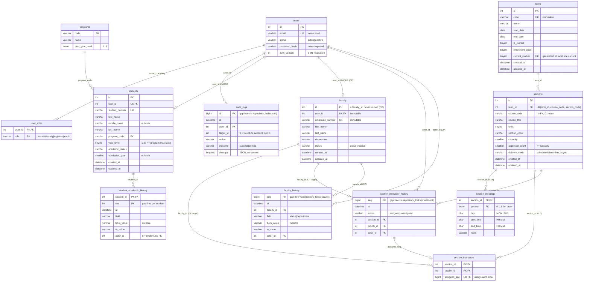
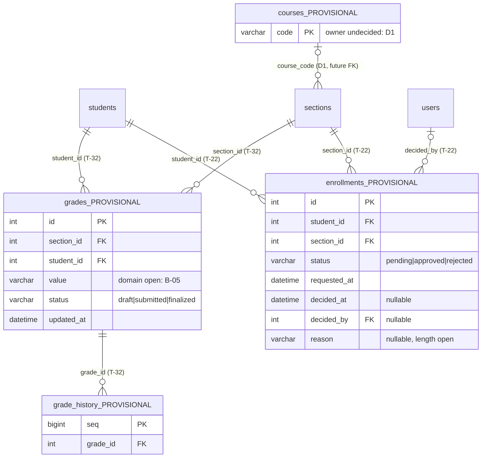

# AIS entity-relationship diagram (T-60)

> **Status: CONDITIONALLY APPROVED (owner, 2026-11-21; safeguards S1–S10 in `docs/plans/T-60-database-architecture.md` §0). Implementation and testing against `ais_test` only; no cutover. Original note:** Diagram 1 shows confirmed tables (from implemented code) and the T-30 tables (confirmed by an approved plan, not implemented: marked `CP`). Diagram 2 shows **provisional** placeholders only. They are not proposed for creation (`DATA_DICTIONARY.md` §6).

Column details, types and constraint text are in `DATA_DICTIONARY.md`. This page shows the keys and relationships.

## 1. Confirmed schema (plus T-30, CP)

Infrastructure tables with no relationships: `repository_locks(name PK, last_seq)` and `schema_migrations(version PK, …)`.

## 2. Provisional placeholders (not proposed for creation)

## 3. Relationships explained

### 3.1 One-to-one

- **`users` 1 : 0..1 `students`.**
  - `students.user_id` is UNIQUE, NOT NULL, FK → `users.id`.
  - A student profile always belongs to exactly one account. An account has at most one profile, ever (T-10 criterion 1).
  - `users.id` and `students.id` are different id spaces (`API_CONTRACTS.md` §1). Nothing compares them.
- **`users` 1 : 0..1 `faculty` (CP).**
  - `faculty.user_id` is UNIQUE, NOT NULL, FK → `users.id`, and immutable (T-30 F2).
  - `faculty.id` is the `faculty_id` that T-21 assignments carry (F1). It is never equal to the user id by design (T-30 §9 support data).
  - The mapping user id → `faculty_id` is `FacultyDirectory::findByUserId`, which resolves B-11.
- **`section_instructor_history` 1 : 0..1 `section_instructors`.** Every current assignment points (`assigned_seq`, UNIQUE) at the `assigned` history row that created it. An `unassigned` row, or an `assigned` row whose assignment was later removed, has no current row.

### 3.2 One-to-many

| Parent → child | Meaning | Cardinality limits | Enforced by |
|---|---|---|---|
| `users` → `user_roles` | Role set of an account | 1..4 rows (non-empty: the app; ≤ 4 and known values: PK + CHECK) | PK, CHECK, `User::fromArray` |
| `users` → `audit_logs` (actor) | Who performed an admin action | — | FK |
| `programs` → `students` | Program of a student | year level ≤ `max_year_level`: app, in the lock | FK; `StudentService` `$check` |
| `students` → `student_academic_history` | Academic change log | gap-free `seq` per student | PK, app |
| `terms` → `sections` | Sections offered in a term | natural key unique per term | FK, UNIQUE |
| `sections` → `section_meetings` | Timetable | 0..14 (PK + `position <= 13`); ≥ 1 if `scheduled`, no self-overlap: app | PK, CHECK, `Section::fromArray` |
| `sections` → `section_instructors` | Current instructors | 0..5: app | PK, app |
| `faculty` → `section_instructors` | Current teaching assignments | no same-term overlap: app | FK, app |
| `sections`, `faculty`, `users` → `section_instructor_history` | Assignment audit (subject section/faculty, actor) | gap-free global `seq`; replay = current set (T-21 A11): verifier | FKs, `verify.php` |
| `faculty` → `faculty_history`, `users` → `faculty_history` (CP) | Profile audit (status, department) | gap-free global `seq`; replay = current values: verifier | FKs, `verify.php` |

Audit rows that point at a user **without** an FK, on purpose:

- `audit_logs.target_id`: 0 means a denied create.
- `student_academic_history.actor_id`: 0 means the system or seeder.

Both are documented contract values (`ARCHITECTURE.md` §8).

### 3.3 Many-to-many

- **`sections` M : N `faculty` through `section_instructors`.**
  - **Owner:** Team 4 owns this relationship (B-04). Team 5 keeps no copy of it.
  - **Payload:** the join row carries only `assigned_seq`, the assignment order. Names are resolved at read time through `FacultyIdentityLookup`, so no faculty data is duplicated.
- **`users` M : N role values through `user_roles`.** The role side is a fixed value set checked by CHECK, not a table (`ARCHITECTURE.md` §4, OQ-2).

### 3.4 Provisional relationships (diagram 2)

None of these is designed beyond what the API contract already names. Each one waits for its plan.

- **`enrollments`** (T-22): N per student and per section. At most one `pending`/`approved` row per (student, section) through a generated-column UNIQUE key. `term_id` is derived from the section. Open questions: B-08 and the eligibility statuses (`BLOCKERS.md`).
- **`grades`** (T-32): at most one per (section, student). History is append-only. The value domain (B-05) is open. Whether a grade needs an approved enrollment row is open.
- **`courses`** (D1): a future FK from `sections.course_code`, after reconciliation.

## 4. Identity rules the diagram must not break

1. `users.id`, `students.id` and `faculty.id` are three separate id spaces. Each one has to be mapped explicitly (`findByUserId`), never compared.
2. `students.user_id` and `faculty.user_id` are UNIQUE and NOT NULL. Neither is ever re-pointed (T-10 PATCH refuses `user_id`; T-30 F2).
3. `section_instructors.faculty_id` → `faculty.id`, which is permanent and never reused (T-30 F1).
4. **The FK at cutover** (plan §3 D-08):
   - Only in the mock world (tests and development) can assignments exist without a faculty row, because test doubles stand in for the lookup.
   - In production, until T-30 is wired, `UnavailableFacultyIdentity` refuses every assignment, so production stores have **no** assignments without a profile.
   - After T-30, an assignment needs an active profile that the lookup has read first.
   - The importer therefore **aborts** if any assignment or history row names a `faculty_id` that has no `faculty` row. It never drops or invents rows (OQ-8).
5. Retained assignments of inactive faculty stay (T-21 Q4/A14). The FK is about existence, not status. Status is read live by the lookup.

## Rendering validation (owner safeguard S9, 2026-11-21)

- **Tool:** `@mermaid-js/mermaid-cli` 11.4.2 (`mmdc`), run by Claude in a scratch folder outside the repository.
- **Result:** both diagrams in this file parsed and rendered without errors. Diagram 1 (`erd-1.svg`) contains all 13 related tables: `users`, `user_roles`, `audit_logs`, `programs`, `students`, `student_academic_history`, `terms`, `sections`, `section_meetings`, `section_instructors`, `section_instructor_history`, `faculty` and `faculty_history`. Diagram 2 contains the provisional `enrollments`, `grades`, `grade_history` and `courses`.
- **Not drawn, on purpose:** `repository_locks` and `schema_migrations`, which have no relationships. They are listed above.
- **Manual check:** relationships and cardinalities match the prose.
- **Re-run after any edit:** `npx -p @mermaid-js/mermaid-cli@11.4.2 mmdc -i docs/database/ERD.md -o erd.svg`.
